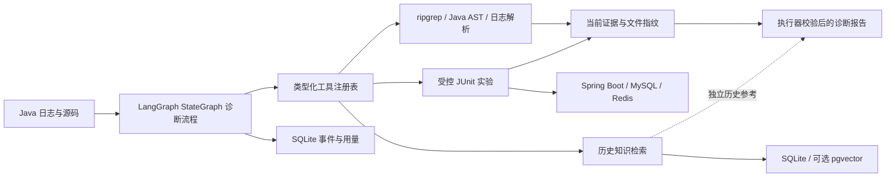

# DevTriage

**面向 Java 后端的证据驱动故障诊断 Agent**

[](https://github.com/spylent-1/devtriage/actions/workflows/ci.yml)
[](pyproject.toml)
[](LICENSE)

给 DevTriage 一份 Java 异常日志和源码目录，它会解析堆栈、自主定位源码、查阅历史知识，并输出带文件位置、行范围与指纹的诊断报告。在配套实验场中，还能运行登记的 JUnit 案例，核对异常断言与健康对照。

**日志 → 源码检索 → 故障假设 → 受控实验 → 证据报告**

0.3.0 将诊断主流程迁移到 LangGraph 状态图；保留既有工具权限、证据校验和 CLI。详见 [版本变更](docs/changelog.md)。

[快速开始](#quick-start) · [报告示例](#report-example) · [架构设计](docs/architecture.md) · [验证记录](docs/validation.md) · [RAG 文档](docs/rag.md)

## 为什么做这个项目

面向需要排查 Java 服务问题的开发者，将“根据日志猜原因”推进到可核对的诊断过程：引用来自实际读取的文件，历史经验与当前证据分别保存，实验成功还需满足具体断言。适合学习诊断 Agent、验证工具执行与证据约束，也可对自己的 Java 仓库做只读辅助排查。

核心 Agent 使用 **Python**；Spring Boot / MySQL / Redis 是随项目提供的**被诊断实验场**。项目不自动修改业务代码，也不声称能替代生产事故排查。

<a id="report-example"></a>
## 看一份真实运行报告

以下内容概括本地实验场的一次真实模型诊断（2026-10-23），输入来自故障复现日志：

| 报告内容 | 示例 |
| --- | --- |
| 故障场景 | 查询不存在的订单，触发空指针异常 |
| 定位方式 | Java 堆栈 + `OrderService.checkout` 源码 |
| 当前证据 | 日志与源码的行范围、SHA256、证据 ID |
| 验证结果 | `case-1` 异常断言与健康对照通过 |
| 最终状态 | `reproduced` |

[完整 Markdown 报告](docs/evidence/case-1-report.md) · [结构化 JSON](docs/evidence/case-1-report.json) · [JUnit 记录](docs/evidence/case-1-junit.xml)

这是独立本地实验的结果，不是生产事故履历。另一份 [RAG 诊断报告](docs/evidence/rag-smoke-report.md) 展示了证据不足的情况：检索到连接池手册后，仍因缺少运行时指标返回 `insufficient`。

## 核心能力

| 能力 | 实现与边界 |
| --- | --- |
| 自主源码定位 | LangGraph StateGraph 编排 ReAct 工具循环、Tool Calling、ripgrep 字面检索、Tree-sitter Java 符号定位 |
| 可核验证据 | 执行器生成引用，报告结束前重验文件指纹；拒绝未知或过期证据 |
| 受控实验 | 仅执行内置案例，逐次隔离输出，检查 JUnit 断言、预期异常、栈帧和健康对照 |
| 历史知识 RAG | BM25 + 可选 Embedding/RRF；默认 SQLite，可选 PostgreSQL/pgvector；历史引用单独保存 |
| 执行留痕 | SQLite 保存任务、工具结果、用量及失败状态；可选 Langfuse/OpenTelemetry 元数据遥测 |

报告状态：`supported` 表示当前日志与源码证据支持；`reproduced` 还要求相匹配的实验通过；`insufficient` 表示缺少证据或执行未完成。引用真实性校验不保证模型的根因推断必然正确。

## 工作流程



<a id="quick-start"></a>
## 快速开始

需要 **Python 3.12+、Git、ripgrep（`rg`）**。仅使用知识检索时无需模型密钥或 Docker。源码安装是完整体验的入口；wheel 只包含 Python 包，不包含实验场与评测资产。

### Windows / PowerShell

先安装 ripgrep（已安装且 `rg --version` 可用时跳过）：

```powershell
winget install BurntSushi.ripgrep.MSVC
# 安装后重新打开终端，让 PATH 生效
git clone https://github.com/spylent-1/devtriage.git
cd devtriage
py -3.12 -m venv .venv
.\.venv\Scripts\python -m pip install -r requirements.lock
.\.venv\Scripts\python -m pip install --no-deps -e .
Copy-Item .env.example .env
.\.venv\Scripts\devtriage doctor
```

以下命令使用 `devtriage` 简写。PowerShell 未激活环境时，将其替换为 `.\.venv\Scripts\devtriage`；`python` 同理使用 `.\.venv\Scripts\python`。无需修改系统执行策略。

### Linux / Bash

先确保 `python3.12` 和对应的 venv 支持已安装（Ubuntu/Debian），再执行：

```bash
sudo apt-get update && sudo apt-get install -y ripgrep
git clone https://github.com/spylent-1/devtriage.git
cd devtriage
python3.12 -m venv .venv
source .venv/bin/activate
python -m pip install -e '.[dev]'
cp .env.example .env
devtriage doctor
```

`requirements.lock` 是 Windows / Python 3.12 验证依赖快照；其他平台使用开发依赖解析安装。`doctor` 显示配置与环境可用性，不代表模型或云服务已经端到端验收。

### 1. 无密钥体验历史知识检索

```bash
devtriage knowledge index --source knowledge/runbooks.json --corpus runbooks
devtriage knowledge search "连接池耗尽，怎么区分慢查询和连接泄漏"
devtriage knowledge eval --dataset evals/retrieval.json
```

默认 SQLite + BM25。内置五份资料是整理的示例手册，覆盖事务代理、连接池、死锁、幂等和缓存过期，不是生产故障历史。语义检索需单独配置 Embedding 服务并重新入库，详见 [RAG 文档](docs/rag.md)。

### 2. 运行模型诊断

在 `.env` 填写 `DEEPSEEK_API_KEY`。默认使用 `https://api.deepseek.com` 与 `deepseek-chat`；兼容接口可通过 `DEVTRIAGE_BASE_URL`、`DEVTRIAGE_MODEL` 替换。模型调用按提供商规则计费。

```bash
devtriage diagnose --repo lab/app --log examples/logs/case-1-1.log
devtriage diagnose --repo examples/rag-smoke --log examples/rag-smoke/incident.log
devtriage report <run-id>
```

示例日志为**合成样例**。终端输出 JSON；`.devtriage/<run-id>/` 保存 `report.json` 和 `report.md`。实际 Java 仓库可替换 `--repo` 和 `--log`。工具返回的脱敏日志、源码片段及知识会发给所配置的模型服务，请只使用有权处理的资料；脱敏规则不能保证覆盖所有敏感内容。

### 3. 可选：在实验场复现并验证

需要 Docker Engine 和 Compose v2；Windows 使用 Docker Desktop Linux 引擎。应用只绑定 `127.0.0.1:18080`，MySQL/Redis 不开放宿主端口。

```bash
devtriage lab up
devtriage lab reproduce case-1
# 将 <log-path> 替换成 reproduce 返回的日志路径
devtriage diagnose --repo lab/app --log <log-path> --verify lab
devtriage lab verify case-1
devtriage lab verify case-2
devtriage lab verify case-3
devtriage lab down
```

三个案例分别是查询空值、唯一键冲突、缓存序列化异常。首次 Maven 下载可能较慢，可先运行 `docker compose -f lab/compose.yaml run --rm tests test` 预热依赖。`lab down` 保留数据卷；`lab reset` 会清空本项目实验 orders 表和 Redis 实验库。

实验仅对随项目提供的 `lab/app` 开放。其他仓库即使传入 `--verify lab` 也不能运行测试。模型无法指定 Shell 命令、任意测试名或容器参数。

## 测试与验证

```bash
python -m pytest -q
python -m build --wheel
# 调用真实模型的 12 条合成开发基线，可用 --resume 继续检查点
devtriage eval --dataset baseline
```

CI 覆盖 Windows/Linux Python 测试与构建、Docker/JUnit 实验及 pgvector 集成。默认单元测试不调用付费模型，未启用的集成项会明确跳过。当前执行结果、集成命令与历史记录见 [验证记录](docs/validation.md)；远端状态以 [GitHub Actions](https://github.com/spylent-1/devtriage/actions) 为准。

小型同源合成开发集不代表生产诊断准确率；确定性向量夹具只能验证检索算法和存储链路，不能证明真实语义召回增益。Langfuse SDK 已接入，云端 Trace / Dataset / Experiment 仍需独立验收。

## 设计边界

- 每任务默认 12 轮；工具超时 30 秒，Java 验证 180 秒，模型请求超时 60 秒并有限重试。
- 工具只读允许的文本类型，拒绝越界路径、凭据文件、测试与评测答案；日志、源码及检索内容均视为不可信输入。
- 历史参考保存在 `knowledge_ids/knowledge`，不能替代当前 `evidence_ids/evidence` 或证明实验已复现。
- 上下文裁剪旧工具负载并保留引用 ID；完整事件存于本地 SQLite。任务中断会记录状态，不自动续跑实验。
- 遥测默认只上传运行标识、状态、耗时及用量等元数据，不上传原始日志、源码和消息；不可用时仍保存本地报告。
- 可选语义检索需要独立 Embedding 端点；不将 DeepSeek 对话接口当成 Embedding 服务。知识库当前限制为 5,000 个块，未面向大规模检索优化。

## 文档与后续方向

- [架构与工具边界](docs/architecture.md)
- [RAG 配置、知识格式与 PostgreSQL 部署](docs/rag.md)
- [验收与证据](docs/validation.md)
- [贡献指南](CONTRIBUTING.md)

后续方向：独立保留评测集、运行时指标与数据库会话工具、Git 变更辅助归因。以上属于路线图，不计入当前能力。

## License

[MIT](LICENSE) · 欢迎通过 [Issues](https://github.com/spylent-1/devtriage/issues) 提交已脱敏的复现案例。
