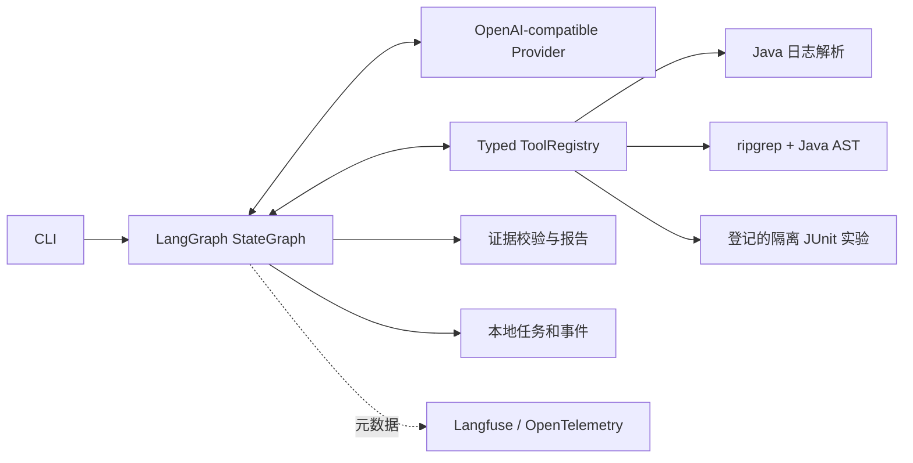

# 架构与扩展点

`DiagnosisRequest` 包含 repo、log 和 verify。`ToolCall`、`ToolResult` 为工具协议；每个工具参数使用拒绝额外字段的 Pydantic 模型。`EvidenceRef` 包含稳定 ID、相对文件路径、完整起止行、文件 SHA256、脱敏文本和证据类型。`VerificationResult` 保存独立实验的异常复现与健康对照结果。模型生成的 verification/evidence 实体不会直接采信，最终由执行器实际结果覆盖。

0.3.0 使用 LangGraph StateGraph 编排日志解析、模型决策、顺序工具执行和报告校验；校验失败返回模型修正，轮次限制按模型调用计数。状态图不提供任务恢复。

一次诊断创建独立 Repository、ToolRegistry 与 SQLite run；模型根据观察结果决定下一工具。每次模型调用/工具执行写事件。模型不拥有 subprocess 参数拼接或工具权限控制能力。`CodeSearch` Protocol 是未来语义检索的替换点；新增检索器仍须返回统一证据，向量命中内容不能绕过文件校验。

实验配置固定在 `lab/compose.yaml`。只有项目内 `lab/app` 的规范化路径可以运行案例工具；读取路径也不能触及测试源。JUnit XML 必须包含成功的登记案例和健康对照、预期异常类型及服务方法栈帧，构建失败、测试缺失、跳过、旧结果都不能标记复现。

SQLite 状态：running → completed / failed / interrupted。中断时保存部分报告；进程被强制终止可能留下 running，启动新任务不会自动重放此任务。首版是单用户 CLI，不提供 HTTP 服务或并行修改能力。

Langfuse SDK 使用自身基于 OpenTelemetry 的观测实现，无需额外重复安装一套全局 TracerProvider。云实验使用 SDK DatasetClient.run_experiment，评分器读取执行结果中的确定性指标；Judge 评分与正确性分开。API 密钥通过环境或本地 dotenv 加载。

## 2.0 RAG 扩展

`knowledge.py` 负责人工知识 JSON 入库、完整行切块、增量 Embedding 缓存、BM25 与余弦召回、RRF 融合和引用重验。`KnowledgeSearch` 通过 `ToolRegistry.register` 接入，独立于当前源码 `CodeSearch`。SQLite 为本地后端，PostgreSQL/pgvector 为可选后端，详见 [RAG 文档](rag.md)。历史参考保存为 `KnowledgeRef`，不改变原有 EvidenceRef 和实验判定要求。
